<!-- ===================== HEADER ===================== -->

  

  

  
  
  

<!-- ===================== ABOUT ===================== -->
## 🤖 `> whoami`

  

<!-- ===================== TECH STACK ===================== -->
## ⚙️ `> tech --stack`

  

  
  
  
  
  

<!-- ===================== PROJECT ===================== -->
## 🛰️ `> projects --featured`

<table>
  <tr>
    <td width="100%">
      <h3>🦷 <a href="https://github.com/hung2004-web/SEP490_G66">OZE Dental Clinic Management System</a></h3>
      
Capstone project (SEP490_G66) · Web system for appointment booking, queues, clinical records, dental imaging, treatment plans and payments.

      
<b>My role:</b> Team leader & backend developer 
      <!-- <b>Built:</b> Auth (login · logout · forgot/reset password) · Room management · Work shift management APIs
 -->
      
      
      
      
      
    </td>
  </tr>
</table>

<!-- ===================== STATS ===================== -->
## 📡 `> system --stats`

  
  

  

<!-- ===================== SNAKE ===================== -->
## 🐍 `> contributions --eat`

  <picture>
    <source media="(prefers-color-scheme: dark)" srcset="https://raw.githubusercontent.com/Hiee2004/Hiee2004/output/github-snake-dark.svg" />
    
  </picture>

<!-- ===================== FOOTER ===================== -->

  

